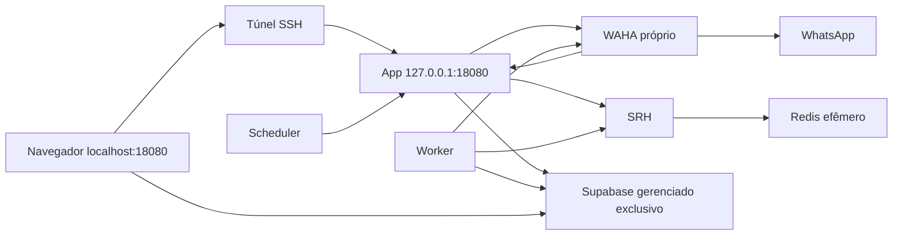

# Piloto isolado TV7 — preparação, deployment NÃO EXECUTADO

Destino: **infraestrutura privada**, opt-in. Nada muda no produto ou nas stacks
existentes sem executar explicitamente este Compose. Não usar o instalador ou o
update automático oficial neste piloto: eles administram outra topologia.

## Origem e versões

Camada independente em `deploy/tv7/isolated-pilot/`: preserva Compose, instaladores,
código e schema do upstream. Base Git da preparação:
`a0c54be04ea70f427bbdcaceb24b4ce63e03cdf0`. O upstream avançou; não houve merge/rebase.

As imagens executáveis são da **release 1.60.0**, não do HEAD do checkout. Os três
digests em `compose.yaml` foram consultados no GHCR sem baixar camadas. Os metadados
OCI de app, worker e scheduler declaram a mesma revisão
`0440d4fc3ffe036521b7619763cba4311617b8a1` (`v1.60.0`) e `linux/amd64`.
O baseline a preparar no Supabase é o dessa revisão. **Não aplicar o baseline da
main atual a essas imagens:** a main contém schema e funcionalidades posteriores.
Para mudar a versão, revisar o trio de imagens, schema, preflight e rollback juntos.
Não é uma recomendação de que 1.60.0 seja a release mais recente.

Dependências: WAHA `latest-2026.7.2` (tag datada oficial), Redis `7.4.3-alpine`
(patch explícito) e SRH com o digest do Compose oficial. Tags de terceiros ainda
podem ser republicadas: registrar seus digests no futuro aceite. Nenhum build local.

## Arquitetura e fontes



| Serviço | Por que existe | Fonte no core |
|---|---|---|
| app | UI, API, webhooks e rotas cron | `Dockerfile`, `docker-compose.prod.yml` |
| worker | Fila e turnos contínuos; usa Postgres SQL além da API | `workers/agent-worker/main.ts`, `lib/agent-engine/db/pool.ts` |
| scheduler | Dispara crons por HTTP interno | `docker/scheduler/entrypoint.sh` |
| waha | Sessões NOWEB e transporte WhatsApp | `docker-compose.prod.yml`, `lib/channels/` |
| redis | Rate limit/debounce efêmeros | `docker-compose.prod.yml` |
| srh | Adapta Redis à API HTTP exigida pelo SDK Upstash | `lib/env.ts`, `lib/redis-config.ts` |

Não entram PostgreSQL, Auth/Storage/Realtime locais, MinIO, Evolution, Caddy,
Traefik, telefonia, WaCalls ou agente de auto-update.

### HTTP via loopback: suportado pelo código

`lib/supabase/cookie-secure.ts` deriva `Secure` de `NEXT_PUBLIC_APP_URL` em runtime;
`server.ts` e `proxy.ts` usam esse helper. O teste co-localizado cobre HTTP.
`NEXT_PUBLIC_APP_URL` e `NEXT_PUBLIC_ADMIN_URL` ficam em `http://localhost:18080`.
A imagem genérica injeta Supabase público em runtime (`PublicEnvScript`): não exige build.
Portanto HTTPS/proxy não são necessários para este acesso via SSH. Login real,
recuperação e cookies **ainda precisam de prova no navegador após autorização**.

No Windows, manter aberto:

```powershell
ssh -N -o ExitOnForwardFailure=yes -L 127.0.0.1:18080:127.0.0.1:18080 deskcomm-vps
```

Abrir `http://localhost:18080`; não alternar com `127.0.0.1` no navegador, para não
mudar origem/cookies. O bind do túnel também é loopback. Sem túnel, sem UI.
O navegador precisa alcançar o Supabase pela internet para Auth/Storage/Realtime.
Links públicos para clientes, OAuth e webhooks de terceiros não são casos de aceite
deste piloto privado. Nenhum endpoint será publicado para resolvê-los nesta etapa.

### Redes, volumes e hardening

- Projeto `deskcomm_iso`, sem `external`, host networking, devices ou Docker socket.
- `deskcomm_iso_backend`: bridge **internal**, `172.29.240.0/24`, gateway `.1`.
- `deskcomm_iso_edge`: bridge com saída, `172.29.241.0/24`, gateway `.1`.
- App, worker e WAHA usam ambas para sair a Supabase/IA/WhatsApp.
- Redis, SRH e scheduler usam somente backend. Acesso interno não é autenticação
  entre containers; comprometimento de um serviço da bridge continua relevante.
- Volumes: `deskcomm_iso_waha_data` e `deskcomm_iso_waha_media`, ambos locais.
- Redis não persiste: `save` vazio, AOF desligado, `/data` em tmpfs de 16 MiB.
- `no-new-privileges:true` e logs `json-file`, 10 MiB × 3 por serviço.
- Sem `read_only`, troca forçada de UID ou remoção indiscriminada de capabilities:
  Next escreve cache, WAHA escreve sessões e o scheduler escreve crontab/inicia crond.
  Preservamos os usuários das imagens; worker/scheduler podem rodar como root nelas.

O inventário de 28/09/2026 registrou `172.17.0.0/16`, `172.18.0.0/16`,
`10.0.0.0/24`, `10.0.1.0/24`, `10.0.2.0/24`. As rotas/interfaces locais foram
reconsultadas na preparação, sem conflito nas candidatas ou VPN visível.
O daemon privilegiado não foi reconsultado pelas ferramentas (sudo por terminal);
o **preflight real exige nova inspeção de todas as networks**, rotas e interfaces.

Somente `127.0.0.1:18080 -> app:3000/tcp` é publicado. `18443`, `18787` e `13030`
continuam sem uso; as quatro portas são reconferidas pelo preflight.
Nada conecta em `techvision`, ingress ou recursos legados.

### WAHA Core e assinatura

O core registra que a build Core 2026.7.2 não envia HMAC mesmo quando configurado.
Mantemos `WAHA_WEBHOOK_REQUIRE_SIGNATURE=false`, como o instalador oficial,
e chave SHA512 na API. O webhook usa `http://app:3000` na bridge.
Sem Caddy, a rota global também fica acessível por loopback/túnel: qualquer usuário
local autorizado a alcançar essa porta deve ser considerado confiável. Não mudar
o bind para `0.0.0.0`; exposição pública exigiria revisão do webhook/proxy/HMAC.

## Recursos e prontidão

| Serviço | RAM máxima | CPUs máximas | Healthcheck |
|---|---:|---:|---|
| app | 768 MiB | 1,5 | TCP local 3000, liveness oficial |
| worker | 512 MiB | 1 | `/healthz` via wget |
| waha | 1280 MiB | 1,5 | `/ping` via curl, sem API key |
| redis | 256 MiB | 0,5 | `redis-cli ping` |
| srh | 128 MiB | 0,25 | POST JSON `["PING"]` autenticado; resultado PONG |
| scheduler | 128 MiB | 0,25 | `pgrep crond` |
| **Total** | **3072 MiB** | **5** | |

App/worker/WAHA preservam os limites oficiais; os comentários do Compose oficial
citam medições em outra VPS, não prova neste host. Redis tem `maxmemory=128mb` e
`noeviction`: deixa margem para overhead e recusa escrita ao atingir o teto, sem
apagar silenciosamente contadores. SRH/scheduler precisam de confirmação sob carga.
Eliminando o proxy, o orçamento preliminar cai de 3200 para 3072 MiB.
Limites de CPU são tetos, não reservas. Não há reservas de memória.

Snapshot legado: 2426 MiB nos containers, 7831 MiB disponíveis no host, sem swap.
Preflight exige 5120 MiB disponíveis (piloto + 2048 MiB de margem), 15 GiB livres
no filesystem Docker e 100 mil inodes. Isso não prova picos; o legado tem 12 GiB
em limites mais serviços ilimitados. Redis/SRH saturados podem afetar rate limit.

Redis e WAHA precisam estar healthy; SRH aguarda Redis e o app aguarda SRH healthy.
Worker/scheduler aguardam a liveness do app. O app healthy não prova schema/login;
crond vivo não prova cron autorizado. `restart: unless-stopped` reinicia processos
que saem, **não reinicia automaticamente containers apenas unhealthy**.
O PING SRH é um comando real da API (body, não `/ping`); a sonda usa wget/grep da
base Alpine. Nenhuma dessas sondas foi exercitada em containers nesta etapa.

## Contrato Supabase e segredos

Criar posteriormente **projeto novo e exclusivo**, fora desta tarefa. Usar
`.env.example` desta pasta, nunca o `.env` legado/raiz. `.gitignore` da raiz já
ignora `.env`; somente o template é versionado. Arquivo real com modo 600,
sem `source`, sem impressão de `docker compose config` com valores reais.

| Variável | Contrato |
|---|---|
| `NEXT_PUBLIC_SUPABASE_URL` | URL HTTPS do projeto gerenciado |
| `NEXT_PUBLIC_SUPABASE_ANON_KEY` | JWT `anon` do mesmo projeto; público no browser |
| `SUPABASE_SERVICE_ROLE_KEY` | JWT `service_role`; somente app/worker |
| `SUPABASE_DB_URL` | Session pooler, porta 5432, projeto correspondente, senha percent-encoded e TLS |
| `SUPABASE_DB_ADMIN_URL` | Não enviado; forçado vazio. Credencial DDL só no procedimento externo futuro |
| `SUPABASE_SERVER_URL` | Vazio: mesma URL HTTPS pública no servidor |

Não há URI separada obrigatória para Auth, Storage ou Realtime: os SDKs derivam
os endpoints da URL Supabase. Para este piloto, o preflight exige as chaves JWT
legadas compatíveis com o contrato atual; não presume compatibilidade de chaves
`sb_publishable_`/`sb_secret_` sem validar os caminhos do core.

O host não tem rota IPv6 observada. Usar Session pooler IPv4, **não transaction
pooler 6543**. O worker mantém conexões e SQL cru. O preflight confere formato,
ref/papel do JWT e correspondência da URI; não valida assinatura/autenticidade,
conectividade, privilégios ou exclusividade do projeto remoto.

Demais segredos obrigatórios estão no template: três cifras base64 de 32 bytes;
segredos hex independentes de 32 bytes; hash SHA512 da chave WAHA; mesmo SRH_TOKEN
usado pelo proxy e clientes. Gerar futuramente em ambiente protegido, sem chat.
Não guardar senha do dono, token Management API ou credencial de schema no Compose.
IA é opcional para boot, mas precisa de credencial e orçamento para aceite do agente.

### Preparação externa obrigatória antes do primeiro up

1. Criar projeto exclusivo e confirmar que nenhuma instalação legada o usa.
2. Aplicar o **baseline da revisão da release 1.60.0**, com dono do banco,
   extensões/precondições do instalador dessa revisão e erro fatal em falha SQL.
   Não percorrer migrations antigas nem usar o baseline posterior da main.
   Confirmar RLS/grants, bucket privado `whatsapp-media`, demais buckets do
   baseline e publicação Realtime. Este repositório não executa essa etapa.
3. Criar o dono via Auth e promover pelo procedimento de bootstrap da mesma
   revisão; o piloto usa `SIGNUP_MODE=so_convite`. Não basta cadastrar um usuário
   sem o papel de plataforma/organização previsto pelo core.
4. Auth: Site URL `http://localhost:18080`; allowlist de redirects
   `http://localhost:18080/auth/confirm` e `http://localhost:18080/auth/callback`,
   com variantes de query de signup/recovery conforme `marca-emails.sh`.
   Nos modelos confirmation/recovery usar o contrato do core:
   `<a href="{{ .RedirectTo }}&token_hash={{ .TokenHash }}">Continuar</a>`.
   O app fornece `?type=signup` ou `?type=recovery`. Configurar o HTML no painel;
   não apontar o servidor Supabase para uma URL de template em localhost.
   O link será aberto no browser com o túnel ativo. Testar confirmação/reset.
5. Confirmar acesso externo HTTPS a Auth/REST/Storage/Realtime e TLS do pooler;
   revisar SMTP/cotas do projeto. Nenhum backup automático é presumido.
6. Somente após esses checks, declarar `PILOT_SUPABASE_READY=yes` e
   `PILOT_SCHEMA_RELEASE=1.60.0` no arquivo privado. São atestações humanas, não
   evidência produzida pelo preflight. Preparar [backup](backup.md).

## Preflight e validação estática

Requer Bash, Python 3, Docker CLI/Compose e, para host real, `ip` e `ss`.
Não instala ferramentas, não usa sudo automaticamente, não faz bind, pull, SQL,
requisição a Supabase, criação/remoção nem correção. Consulta o socket local padrão.
Falha de inspeção é bloqueio, não uma lista vazia interpretada como sucesso.

```bash
cd /opt/deskcomm/core
bash deploy/tv7/isolated-pilot/preflight.sh --static
python3 -B -m unittest discover -s deploy/tv7/isolated-pilot -p 'test_*.py' -v
bash -n deploy/tv7/isolated-pilot/preflight.sh
docker compose -p deskcomm_iso --env-file deploy/tv7/isolated-pilot/.env.example -f deploy/tv7/isolated-pilot/compose.yaml config --quiet
```

O modo `--static` não consulta o daemon, aceita placeholders e **não autoriza up**.
O modo real exige `.env` privado, formato dos segredos, atestações, recursos e
inventário novo. Recusa qualquer container anterior do projeto, mesmo parado,
e qualquer volume/network com nome previsto, mesmo compatível: é gate de
**primeira implantação**, não de atualização/reinício. Nunca apaga uma colisão.

## Deployment futuro — NÃO EXECUTADO

Somente depois de aprovação do PR, preparação externa acima e autorização para
alterar infraestrutura. Não executar o instalador oficial, `single-server`,
`update.sh`, auto-update pela UI ou `docker stack` para este piloto.

No mesmo terminal autenticado para sudo:

```bash
cd /opt/deskcomm/core
sudo bash deploy/tv7/isolated-pilot/preflight.sh &&
sudo docker compose -p deskcomm_iso --env-file deploy/tv7/isolated-pilot/.env -f deploy/tv7/isolated-pilot/compose.yaml pull &&
sudo bash deploy/tv7/isolated-pilot/preflight.sh &&
sudo docker compose -p deskcomm_iso --env-file deploy/tv7/isolated-pilot/.env -f deploy/tv7/isolated-pilot/compose.yaml up -d --no-build --pull never --wait --wait-timeout 300
```

O segundo preflight mede disco e disponibilidade novamente após baixar imagens.
Não há trava entre inspeção e up: alteração concorrente pode invalidar o snapshot.
`--wait` sem erro não prova toda a aplicação. Se falhar, não repetir cegamente;
inspecionar `ps`/health por campos selecionados, preservar dados e usar o rollback.

Aceite futuro: login/reset via túnel; upload/leitura privada de Storage; Realtime
entre duas abas; crons com efeito verificável; conexão WAHA, recebimento e envio
de teste autorizado; worker consumindo fila e IA com ferramenta conferida em par.
Observar RAM/CPU e OOM sob carga. Não publicar logs completos com dados de clientes.
Uma falha exige diagnóstico visível e próximo passo, não uma declaração de sucesso.

## Backup, rollback e limites da prova

Ver [backup](backup.md) e [rollback](rollback.md). Preparação estática não executa
backup, restauração, migrations, criação do dono ou validação visual. Nenhum projeto
Supabase foi criado. Node/pnpm/dependências não estavam instalados neste host;
typecheck/lint/unit do aplicativo e a suíte completa `pnpm test:shell` não foram
executados. O PR declara os testes estáticos efetivamente medidos.

Validação desta entrega: `docker compose config --quiet`, `preflight.sh --static`,
sintaxe Bash/Python e 19 testes do preflight passaram. Os testes incluem alterações
em memória que abrem bind, ligam rede legada, publicam 80 e trocam imagem/limites;
todas são recusadas. O teste oficial `tests/shell/scheduler-entrypoint.test.sh`
também passou com crond/curl simulados. A tentativa de `pnpm test:shell` terminou
com ferramenta ausente. O preflight real saiu 1 por ausência do `.env` privado,
como esperado. Nenhum resultado simulado é apresentado como sondagem da VPS.

### Living System Checklist

1. Entrada: `.env` privado, modelo Compose e inventário local no `preflight.py`.
2. Saída: bloqueio/OK no terminal para o operador decidir sobre o futuro up.
3. Registro: mensagens sem valores de secrets; validações registradas no PR.
4. Visibilidade: terminal e README; após deployment, UI existente, sem tela nova.
5. Porta: `preflight.sh`; acesso à UI pelo túnel documentado.
6. Anti-morte: saída 1 no bloqueio, healthchecks e restart de processos encerrados.
7. Configuração: template e seção Supabase; ausência causa bloqueio nomeado.
8. Continuidade IA/humano: core preservado; worker/scheduler mantidos; aceite em par pendente.
9. Retorno: falha impede deployment; operador corrige a causa e repete a inspeção.
10. Mapa: diagrama acima, mantido junto desta camada privada para evitar conflito no core.

### Referências externas consultadas

- [Supabase: conexões e Session pooler](https://supabase.com/docs/guides/database/connecting-to-postgres)
- [Supabase: redirects Auth](https://supabase.com/docs/guides/auth/redirect-urls)
- [Supabase: backups](https://supabase.com/docs/guides/platform/backups)
- [SRH: comandos no body e configuração](https://github.com/hiett/serverless-redis-http)
- [Changelog Supabase 15.19/17.11](https://supabase.com/changelog/postgres-15-19-17-11-breaking-changes):
  revisão consultada; projeto novo não tem dados legados a recifrar, mas compatibilidade
  do baseline com a versão efetiva do banco ainda deve ser comprovada.
